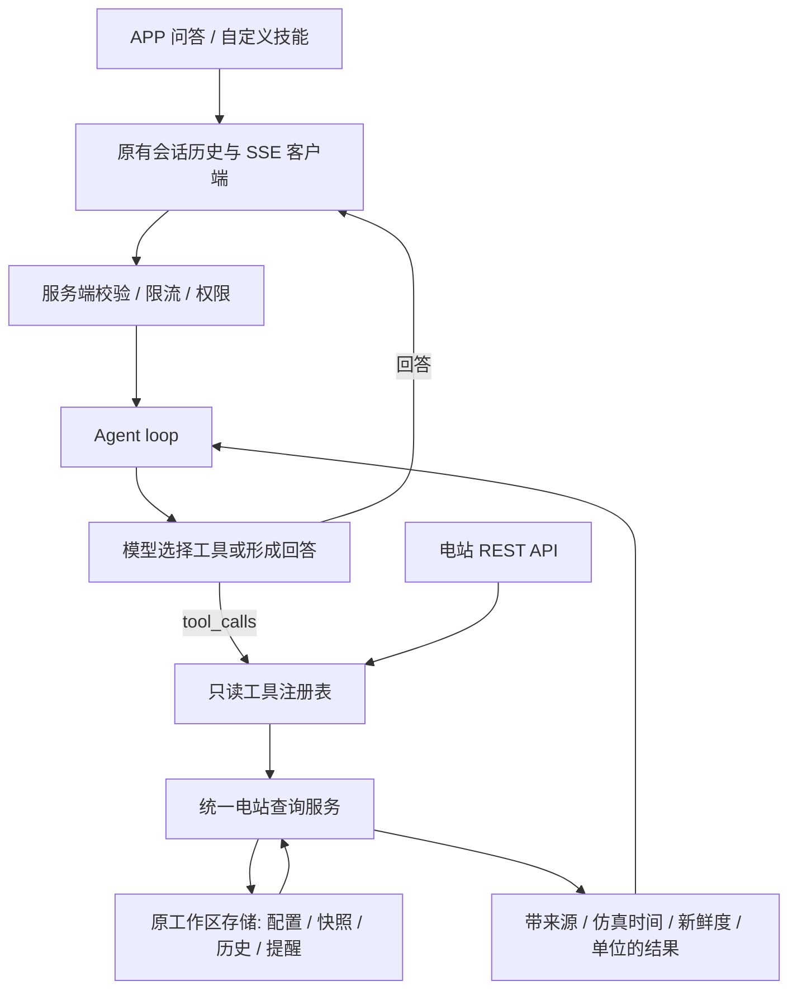

# 光伏 Agent loop 与电站数据接口

本次基于原 `solar-monitor-site` 代码升级，Node.js 与 Worker 使用同一实现，不增加第三方运行依赖。电站配置、快照、历史和提醒仍由原工作区存储维护。



## 与原架构的差异

原来是一次查询规划、执行工具、一次回答。现在每轮均提供完整工具定义，模型可以根据结果选择继续查询，例如：目录 → 实时温度 → 相关小时历史 → 告警事件 → 综合回答。工具结果作为 `tool` 消息回传，模型不能提交任意代码或自行注册工具。

第一轮要求调用 `query_workspace`，随后自动选择工具。最后一轮或工具预算耗尽后要求形成回答；若模型仍未完成则明确报错。浏览器继续维护原有会话历史和业主记忆，本次没有增加后台自主巡检或服务端持久化聊天会话。

## 边界与运行配置

| 环境变量 | 默认值 | 含义 |
|---|---:|---|
| `AGENT_MAX_STEPS` | 8 | 最多模型轮数，允许 2–16 |
| `AGENT_MAX_TOOL_CALLS` | 24 | 最多工具调用，允许 1–60 |
| `AGENT_TIMEOUT_MS` | 180000 | 整次分析超时，含全部模型轮次 |
| `CHAT_TIMEOUT_MS` | 120000 | 单次模型请求超时 |

每轮最多 6 次工具调用。相同工具和参数第三次出现时停止循环。参数最长 16000 字符，单次结果超过 100000 字符时反馈缩小范围，总上下文超过 600000 字符时停止。查询参数错误反馈给模型修正；用户取消会中止模型网络请求。上述是字符预算和次数限制，不是精确 token 或费用计费。

流式问答会透传可见回答，并发送 `agent` 状态事件：`model_start`、`tool_start`、`tool_end`、`completed`。客户端显示分析步数和查询状态；工具参数、完整工具数据与模型私有推理不传到界面。错误用 SSE `error` 事件返回，只有正常完成才发送 `[DONE]`。

## 电站数据接口

在线接口描述：`GET /api/workspace/data/openapi.json`。

| 路由后缀 | Agent 工具 | 数据 |
|---|---|---|
| `/catalog` | `list_plants` | 目录、可查询类别、历史覆盖范围 |
| `/plants/{plantId}/realtime` | `get_plant_realtime` | 实时功率、SOC、温度、仿真时钟 |
| `/plants/{plantId}/config` | `get_plant_config` | 电站配置和装机容量 |
| `/plants/{plantId}/devices` | `get_plant_devices` | 仿真逆变器、储能虚拟设备 |
| `/plants/{plantId}/history` | `query_plant_history` | 逐日、逐小时记录与区间汇总 |
| `/plants/{plantId}/samples` | `get_plant_samples` | 有限近期采样 |
| `/plants/{plantId}/alarms` | `get_plant_alarms` | 当前仿真告警和提醒事件 |
| `/plants/{plantId}/weather` | `get_plant_weather` | 仿真云量、实测与预报可用性 |
| `/plants/{plantId}/tariffs` | `get_plant_tariffs` | 电价和币种 |
| `/plants/{plantId}/energy` | `get_plant_energy` | 能量流、当日电量和收益 |
| `/plants/{plantId}/health` | `get_plant_health` | 温度、SOC、数据停更和预警依据 |
| `/plants/{plantId}/reports` | `get_plant_reports` | 月报和原有报告下载链接 |
| `/plants/{plantId}/operations` | `get_plant_operations` | 运行权和指令状态，需要管理鉴权 |

所有后缀加前缀 `/api/workspace/data`，GET 查询。另有 `POST /api/workspace/data/query` 批量入口，复用 `query_workspace` 的 `queries` 参数，每次最多 6 项；每项错误在 `results[].data.error` 中表达。现有历史 CSV、月报下载、仿真发布和受控指令接口继续可用。新增 Agent 工具全部只读。

单站 GET 查询支持原有日期、分辨率、筛选与分页参数，例如：

```text
GET /api/workspace/data/catalog
GET /api/workspace/data/plants/P3/realtime
GET /api/workspace/data/plants/P3/history?lastDays=7&resolution=summary
GET /api/workspace/data/plants/P3/history?dayOffset=-1&resolution=hourly&startHour=10&endHour=11
GET /api/workspace/data/plants/P3/alarms?status=active
```

批量查询请求体：

```json
{"queries":[{"scope":"current","plantIds":["P3"]},{"scope":"history","plantIds":["P3"],"lastDays":7,"resolution":"summary"}]}
```

`P3` 仅示例，请从目录取得实际 ID。相对日期默认真实北京时间，只有明确查询仿真日历才设置 `calendar=simulation`。历史 `endHour` 包含对应小时：10:00–12:00 应设 10 和 11。

结果保留原查询服务的 `source`、`queriedAtBeijing`、`simulationTime`、`snapshotAgeSeconds`、`stale`、`units` 与历史覆盖范围。数据停更阈值仍为 30 秒；没有保存的字段返回 `null`，没有历史记录不能据此认定发电量为零。汇总必须结合记录数和缺失天数解释。

## 实际数据能力与接入位置

目前数据源是服务器保存的仿真数据，不是现场设备平台。设备清单明确标记 `virtual=true`，没有逐台设备序列号。天气接口有仿真云量，但 `available=false`，实测和预报为 `null`。健康接口没有制造综合健康评分或寿命预测。告警接口的日期和状态筛选仅作用于结构化提醒事件，快照告警保留快照语义。

保持原项目权限：电站读数据公开，operations 需要管理 Cookie 或 Bearer 管理口令；新增工具不具备写入或控制权限。公开接口适用于原有单工作区应用，不提供多租户隔离。

真实平台接入应在 `server/workspace-query.mjs` 的数据读取/标准化层对接供应商 API，沿用 `server/station-data.mjs` 的统一参数、元数据与权限；设备、天气和健康分支目前是明确标注能力范围的查询接口，尚未实现华为、阳光电源等厂商连接器。不可把真实测量与仿真结果混标。

## 验证和运行

```sh
node scripts/check.mjs
node server.mjs
```

开发副本不携带原 `.env` 和持久化电站数据。使用原环境运行升级代码时应保留原配置及数据目录；新环境请按 `.env.example` 配置模型密钥与持久化路径。测试使用模型替身和内存电站记录，覆盖多轮决策、修正查询、预算、取消、SSE、HTTP/工具一致性与 Worker 构建，没有以模拟测试代替真实平台联调。
